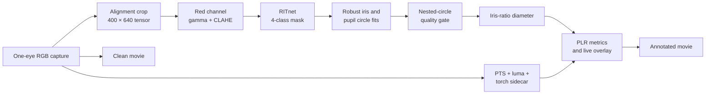
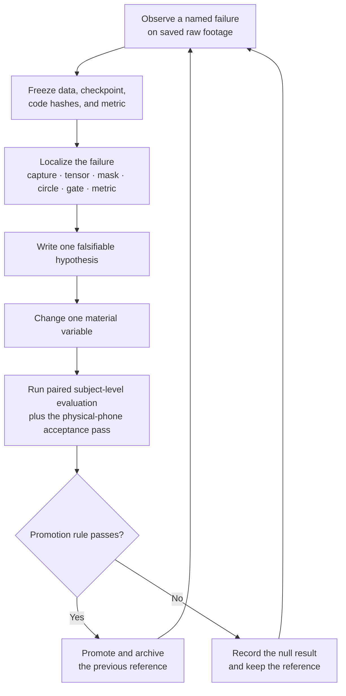

# Pupillometry from a phone camera

Visualyze is an experimental, offline iPhone pupilometer that estimates pupil diameter over
time and pupillary light-reflex (PLR) metrics from a short, one-eye RGB video. It uses no
external optical hardware; the phone camera and torch provide capture and stimulus timing.

> **Positioning.** A triage / screening aid, **not** an FDA-cleared diagnostic. No equivalence
> is claimed to cleared devices (e.g. the NeurOptics NPi). The target user is a nurse or first
> responder in the field, where the alternative is a subjective penlight exam.

The engineering thesis is **a small neural net for structure, classical geometry for the
measurement.** The net says *where* the iris and pupil are; explicit geometry says *how big*.
That keeps the output interpretable and debuggable frame by frame, but it does not make the
millimeter estimate clinically validated.

---

## What it produces

The current iOS build live-tracks one aligned eye, draws pupil and iris outlines, records a PLR
clip, and saves both clean and annotated movies to Photos. A capture sidecar records frame times,
image-quality samples, model fits, and torch timing. The app also shows preliminary resting
diameter, minimum diameter, percent constriction, latency, and constriction velocity.

Millimeters without a scale bar come from using the **iris as a built-in ruler**. The iris
diameter is relatively population-stable (~11.7–12.0 mm), so measuring iris and pupil in the
same frame largely cancels camera distance and digital scale:

```
pupil_mm = (pupil_px / iris_px) * IRIS_MM        # IRIS_MM ≈ 11.7
```

The 11.7 mm constant is a stated source of error for absolute-size metrics. It algebraically
cancels from **percent constriction**, but iris-fit drift, pupil-fit error, perspective, and
off-axis gaze do not. Those remain measurement-error sources that need paired validation.

---

## Architecture



- **RITnet** ([Chaudhary et al.](https://github.com/AayushKrChaudhary/RITnet)), a 0.25 M-param
  segmentation net (background / sclera / iris / pupil). The weight file is small, but the
  current 400×640 network is still compute-heavy; device latency/resolution ablation remains
  required. It expects
  near-eye, OpenEDS-style framing, so each clip is cropped to the eye and reframed before
  inference — the single highest-leverage fix in the project (nearly every early failure traced
  to framing, not the algorithm).
- **Measurement layer (classical).** The iris is fit as a **circle** from limbus points selected
  by sclera adjacency; the pupil is fit to the rim of RITnet's pupil class. The Python curve
  builder can lock the iris radius to a lit-frame median. The iOS feedback build currently uses
  the accepted per-frame iris/pupil ratio, so sequence-level ruler parity is still open work.
- **Validity gate.** Rejects frames where the pupil isn't concentric/contained, and flags
  clips that are too sparse or whose baseline window is empty, so the readout marks
  untrustworthy metrics instead of emitting fabricated ones.

---

## Build chronicle

```mermaid
flowchart LR
    A[Whole-face clips<br/>poor framing] --> B[Manual eyeboxes<br/>OpenEDS-style crops]
    B --> C[Red-channel input<br/>tracking + circle gate]
    C --> D[11-subject LOSO<br/>fine-tune ≈ break-even]
    D --> E[Frozen base control<br/>phone IoU 0.694]
    E --> F[SBVPI clean control<br/>pupil IoU 0.914]
    F --> G[Core ML parity<br/>99.979% minimum]
    G --> H[Single-eye iOS build<br/>first smoke test encouraging]
    H --> I[Quantify phone runtime<br/>then one-change ablations]
```



| Checkpoint | Evidence | Decision |
|---|---|---|
| [Local phone GT](evaluation/runs/pretrained_baseline_20260915_g2_fixed/report.md), 351 frames / 11 subjects | Red raw pupil IoU 0.694; visible-frame acceptance 67.7%; gated circle IoU with misses scored zero 0.533; accepted-frame diameter absolute relative error 9.0% | Keep the base model, but treat postprocessing and capture failures as first-class metrics |
| [SBVPI clean oracle crops](evaluation/runs/external_sbvpi_baseline_20260915/report.md), 120 frames / 19 subjects | Red pupil IoU 0.914 and iris-disk IoU 0.884 | The checkpoint can segment clean visible-light eyes; this does not estimate live-phone performance |
| [FP16 Core ML export](evaluation/runs/coreml_parity_20260915/report.md) | Minimum pixel-class agreement with PyTorch 99.979% on three parity crops | Export drift is not the leading explanation for phone failures |
| First iPhone 17 Pro smoke test | User-reported live tracking looked strong | Preserve this build as the mobile reference; collect quantitative latency, thermal, and saved-video evidence next |

The subject cohort is a development set because it has already influenced preprocessing and
postprocessing. A new consented subject-level holdout is required before any final performance
claim.

---

## Engineering decisions worth defending

| Decision | Alternatives rejected | Why |
|---|---|---|
| **Net for structure, geometry for measurement** | end-to-end diameter regression | no labeled-mm data at scale; a scalar regressor throws away the spatial structure that lets every frame be sanity-checked and error-bounded |
| **Circle fit, not ellipse** | 5-DOF ellipse | the lid occludes top/bottom; the two visible side arcs pin a 3-DOF circle but under-constrain an ellipse (which collapses onto the lid) |
| **RITnet, not a promptable generalist** | SAM-family models | a promptable model does not directly provide fixed pupil/iris semantic classes and generally costs more compute; it remains useful offline as a labeling assistant |
| **RITnet, not MediaPipe** | MediaPipe iris | needs a full face and gives landmarks, not a pupil mask |
| **Snap-baseline** | dark pre-flash baseline | PLR latency is ~200 ms, so the pupil holds its dark-adapted size for ~20 frames after light-on; reading resting size from those *lit* frames sidesteps dim-image segmentation without biasing % constriction |
| **Constrain gaze at capture** | monocular 3D gaze correction | gaze normalization would add another unvalidated model; a fixation target is a planned capture control, not yet an implemented or validated correction |

---

## What the diagnostics found (the interesting part)

The project's strongest results are the ones that *redirected* it:

- **The frozen SBVPI control confirms a large capture/domain gap.** On 120 complete,
  oracle-framed DSLR samples across 19 subjects, untouched RITnet reached subject-macro pupil IoU
  0.876 with grayscale and **0.914 with red**, plus red iris-disk IoU 0.884. The 46 complete
  brown-eye samples had frame-mean red pupil IoU 0.933. This proves the checkpoint can segment
  clean, localized visible-light eyes—including brown eyes—but does not test phone localization,
  motion, low light, temporal tracking, or PLR dynamics.
- **The local phone control is materially harder.** On 351 hand-labeled frames from 11 subjects,
  red-channel preprocessing reached subject-macro raw pupil IoU 0.694. Once the current circle
  reconstruction and gate count rejected frames as zero, pupil IoU was 0.533 with 67.7%
  visible-frame acceptance. Forty-six of 60 visible-frame failures were `pupil_not_concentric`,
  making postprocessing the highest-information next ablation.
- **Honest nulls, recorded, not buried:**
  - *Fine-tuning at n=11 subjects* was approximately break-even under the older evaluator and
    varied strongly by held-out subject. It changed several variables together and is not directly
    comparable to the frozen control, so none of those checkpoints replaced pretrained RITnet.
  - *Temporal averaging* of dark frames was motion-confounded (registration blur); parked, not
    claimed as a win.
  - *Automated gaze-filtering* from per-frame iris-fit centers measured fit-jitter, not gaze
    (it flagged the steadiest clip as the worst) — a dead end, recorded so it isn't retried.

**Evaluation discipline:** accuracy is measured with hand-labeled masks (IoU + diameter error)
under a **leave-one-subject-out** split — never a frame-level split, because 120 fps neighbors
leak near-identical frames across train and test.

The frozen pretrained checkpoint is now measured independently by `evaluate_pretrained.py`.
It records checkpoint/data/code hashes and keeps raw segmentation, circle reconstruction, and
product-gate failures separate, with per-subject results and subject-bootstrap confidence
intervals. See the [evaluation contract](evaluation/README.md); fine-tuning stays parked until it
beats this exact contract.

---

## Where it could improve on a penlight exam

The naive worry—“can’t a clinician already eyeball millimeters?”—is useful because it sharpens
the value proposition. Manual pupil assessment is observer-dependent and normally records coarse
size and reactivity categories rather than a time-resolved diameter curve.

- The eye does **fine** at: gross size in good light, an obvious blown pupil, present-vs-absent
  reaction. Marginal value there is low — and the honest pitch says so.
- Human observation alone does not directly produce a timestamped diameter curve, numeric
  velocity, or repeatable measurements across examiners and shifts.
- **Intended value:** numeric constriction velocity, percent constriction, and latency are not
  quantities a person can reliably estimate by eye. If validated against a reference device,
  they could provide a reproducible yardstick for trending rather than a qualitative label.
- **Honest limit:** the pipeline is weakest in dim light and does not have the illumination
  invariance of an infrared device. Its intended advantage is quantified, replayable lit-reflex
  dynamics; that advantage still requires clinical validation.

---

## Repository

```
ritnet_segment.py        detector integration + measurement layer (Stage 1)
plr_metrics.py           mm calibration + PLR metric formulas + validity gate (Stage 2)
video_timing.py          decoded-frame timestamps; no universal-FPS assumption
evaluate_pretrained.py   frozen RITnet baseline + subject-clustered uncertainty
finetune_ritnet.py       visibility-aware LOSO fine-tune pipeline
onboarding/              clips -> hand-reviewed per-frame eyeboxes -> frames_v2
labeling/                circle-label schema -> derived masks and measurement GT
apps/ios/                native Swift capture + experimental Core ML live overlay
```

### Setup

```bash
pip install -r requirements.txt
git clone https://github.com/AayushKrChaudhary/RITnet.git   # detector, not vendored here
```

Input clips go in `data/clips/`; sample data is not included because it contains identifiable
biometric footage handled under written consent. See `onboarding/README.md` for the canonical
reviewed-eyebox pipeline. The checked-in `subject_b_2` readout uses footage specifically approved
for public demo use; the consent record itself belongs in restricted storage, not this repository.

---

## Status & roadmap

**Done:** the Python measurement engine and demo readout, 351 hand-labeled
frames from reviewed per-frame eyeboxes, subject-held-out
evaluation, mixed-FPS decoded-frame timing, a
visibility-aware fine-tuning path, and an experimental iOS Core ML export/live single-eye
overlay. The mobile path uses the pretrained checkpoint because the current LOSO fine-tune did
not qualify as an improvement. The first physical-device smoke test was qualitatively encouraging;
the app remains a feedback instrument, not a validated measurement device.

**Next:** freeze several raw clips from the working phone build; measure sustained inference rate,
end-to-end overlay delay, dropped frames, thermals, active format, and torch onset; compare a
Swift-produced model tensor and circle decision with Python; then execute one controlled
postprocessing ablation around the dominant concentricity failures. Only after that should MOBIUS
pretraining, loss changes, or lower input resolutions be tested.

**Known limits:** the 11.7 mm iris constant and off-axis foreshortening are stated error
sources; recall degrades on dark irises in dim light (visible-light vs infrared physics); older
QuickTime clips have manual rather than hardware-synchronized light onset; and clinical
validation is early (small n, no paired reference-device comparison yet).

---

## Research-engineering iteration loop



The next experiment is **postprocessing P1**, not another broad fine-tune: separate raw-mask
quality, circle reconstruction, and concentricity gating on the 46 rejected-but-often-usable
frames. Candidate changes include robust component selection, partial-arc circle fitting, and a
temporally informed soft confidence score. The hard nested-circle constraint should remain a
measurement safety check until a replacement improves gated IoU and acceptance without worsening
diameter error. After P1, run the untouched checkpoint on MOBIUS; only then choose a narrowly scoped
training hypothesis.
