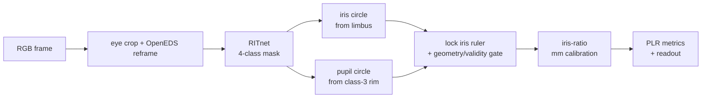

# Pupillometry from a phone camera

Estimate pupil diameter over time and pupillary light-reflex (PLR) metrics from a short
eye-video clip on a phone, **offline and on-device, with no dedicated hardware.**

> **Positioning.** A triage / screening aid, **not** an FDA-cleared diagnostic. No equivalence
> is claimed to cleared devices (e.g. the NeurOptics NPi). The target user is a nurse or first
> responder in the field, where the alternative is a subjective penlight exam.

The engineering thesis: **a small neural net for structure, classical geometry for the
measurement.** The net says *where* the iris and pupil are; explicit geometry says *how big* —
which keeps the millimeter output precise, interpretable, and debuggable frame by frame.

---

## What it produces

Feed in a close-up clip of one eye during a light flash, and the pipeline outputs a
clinician-style readout: a metrics table (resting diameter, minimum, % constriction, latency,
constriction velocity), an annotated pupil-vs-time curve, and detector-overlay frames showing
the fitted iris ruler and pupil drawn on the actual eye as evidence the measurement is real.

Millimeters without a scale bar come from using the **iris as a built-in ruler**. The iris
diameter is population-stable (~11.7–12.0 mm) and does not change with neurological state, so
measuring iris and pupil in the *same* frame cancels camera distance, zoom, and angle:

```
pupil_mm = (pupil_px / iris_px) * IRIS_MM        # IRIS_MM ≈ 11.7
```

The 11.7 mm constant is a stated source of error for the *absolute-size* metrics (resting
diameter, minimum). Conveniently, though, the headline reflex metric — **percent constriction
`(baseline − min) / baseline`** — is a *ratio*, so the constant cancels top-and-bottom: the
number we emphasize most is immune to our least-certain input.

---

## Architecture



- **RITnet** ([Chaudhary et al.](https://github.com/AayushKrChaudhary/RITnet)), a 0.25 M-param
  segmentation net (background / sclera / iris / pupil). The weight file is small, but the
  current 400×640 network is still compute-heavy; device latency/resolution ablation remains
  required. It expects
  near-eye, OpenEDS-style framing, so each clip is cropped to the eye and reframed before
  inference — the single highest-leverage fix in the project (nearly every early failure traced
  to framing, not the algorithm).
- **Measurement layer (classical).** The iris is fit as a **circle** from limbus points
  (selected by sclera adjacency); the pupil is fit to the rim of RITnet's pupil class. Within a
  clip the iris is a fixed ruler, so its radius is **locked** to the median of the lit frames
  while the center tracks per-frame — this alone removes most jitter.
- **Validity gate.** Rejects frames where the pupil isn't concentric/contained, and flags
  clips that are too sparse or whose baseline window is empty, so the readout marks
  untrustworthy metrics instead of emitting fabricated ones.

---

## Engineering decisions worth defending

| Decision | Alternatives rejected | Why |
|---|---|---|
| **Net for structure, geometry for measurement** | end-to-end diameter regression | no labeled-mm data at scale; a scalar regressor throws away the spatial structure that lets every frame be sanity-checked and error-bounded |
| **Circle fit, not ellipse** | 5-DOF ellipse | the lid occludes top/bottom; the two visible side arcs pin a 3-DOF circle but under-constrain an ellipse (which collapses onto the lid) |
| **RITnet, not SAM** | Segment Anything / MobileSAM | SAM is ~600 M+ params (too big for on-device real-time), class-*agnostic* and *promptable* (needs a prompt at the pupil — the chicken-and-egg we're solving), and a natural-image generalist with no edge on the hard low-contrast case. SAM 2 belongs *offline* as a labeling tool, not as the deployed detector |
| **RITnet, not MediaPipe** | MediaPipe iris | needs a full face and gives landmarks, not a pupil mask |
| **Snap-baseline** | dark pre-flash baseline | PLR latency is ~200 ms, so the pupil holds its dark-adapted size for ~20 frames after light-on; reading resting size from those *lit* frames sidesteps dim-image segmentation without biasing % constriction |
| **Fixation at capture, not gaze normalization** | per-frame gaze correction | 3D eye-pose from monocular RGB is hard and adds error; a fixation dot removes gaze movement at the source — same principle as constraining framing and onset |

---

## What the diagnostics found (the interesting part)

The project's strongest results are the ones that *redirected* it:

- **The frozen SBVPI control confirms a large capture/domain gap.** On 120 complete,
  oracle-framed DSLR samples across 19 subjects, untouched RITnet reached subject-macro pupil IoU
  0.876 with grayscale and **0.914 with red**, plus red iris-disk IoU 0.884. The 46 complete
  brown-eye samples had frame-mean red pupil IoU 0.933. This proves the checkpoint can segment
  clean, localized visible-light eyes—including brown eyes—but does not test phone localization,
  motion, low light, temporal tracking, or PLR dynamics.
- **Honest nulls, recorded, not buried:**
  - *Fine-tuning at n=11 subjects* remains break-even and varies by held-out subject. The latest
    visibility-aware LOSO run changed macro pupil detection by +1.0 points but all-frame pupil
    IoU by -0.4 points and detected-only diameter error by +1.0 points (worse). The visibility
    head itself reached only 48.5% macro accuracy / 22.6% visible-boundary recall, so those
    checkpoints are experimental and must not replace the pretrained production candidate.
  - *Temporal averaging* of dark frames was motion-confounded (registration blur); parked, not
    claimed as a win.
  - *Automated gaze-filtering* from per-frame iris-fit centers measured fit-jitter, not gaze
    (it flagged the steadiest clip as the worst) — a dead end, recorded so it isn't retried.

**Evaluation discipline:** accuracy is measured with hand-labeled masks (IoU + diameter error)
under a **leave-one-subject-out** split — never a frame-level split, because 120 fps neighbors
leak near-identical frames across train and test.

The frozen pretrained checkpoint is now measured independently by `evaluate_pretrained.py`.
It records checkpoint/data/code hashes and keeps raw segmentation, circle reconstruction, and
product-gate failures separate, with per-subject results and subject-bootstrap confidence
intervals. See `evaluation/README.md`; fine-tuning stays parked until it beats this exact contract.

---

## Why this beats the penlight (the pitch)

The naive worry — "can't a clinician already eyeball millimeters?" — is half-right, and
following it sharpens the value proposition. The literature shows manual pupil assessment is
unreliable: examiners round to whole/half mm and are off by ≥0.5 mm, agreement with a
pupillometer is near coin-flip, small anisocoria (0.5–1 mm, the early-warning zone) is missed,
and "brisk/sluggish/fixed" has poor inter-rater agreement.

- The eye does **fine** at: gross size in good light, an obvious blown pupil, present-vs-absent
  reaction. Marginal value there is low — and the honest pitch says so.
- The eye **cannot** produce: reproducible absolute mm, small-anisocoria detection, *any*
  reactivity gradation as a number, or serial consistency across examiners and shifts.
- **Real value:** (1) metrics that are imperceptible to the eye — constriction velocity,
  % constriction, latency — a *capability* humans lack, not a precision upgrade; subtle
  deterioration shows in dynamics before gross size. (2) an objective, reproducible yardstick
  for **trending** (the pupillometer's own premise).
- **Honest limit:** the pipeline is weakest in dim light / dark irises — the same regime humans
  are weakest — so unlike an infrared device it doesn't rescue the hardest cases. Its win is the
  *lit* reflex dynamics.

---

## Repository

```
ritnet_segment.py        detector integration + measurement layer (Stage 1)
plr_metrics.py           mm calibration + PLR metric formulas + validity gate (Stage 2)
video_timing.py          decoded-frame timestamps; no universal-FPS assumption
evaluate_pretrained.py   frozen RITnet baseline + subject-clustered uncertainty
finetune_ritnet.py       visibility-aware LOSO fine-tune pipeline
onboarding/              clips -> hand-reviewed per-frame eyeboxes -> frames_v2
labeling/                circle-label schema -> derived masks and measurement GT
apps/ios/                native Swift capture + experimental Core ML live overlay
```

### Setup

```bash
pip install -r requirements.txt
git clone https://github.com/AayushKrChaudhary/RITnet.git   # detector, not vendored here
```

Input clips go in `data/clips/`; sample data is not included because it contains identifiable
biometric footage handled under written consent. See `onboarding/README.md` for the canonical
reviewed-eyebox pipeline. The checked-in `subject_b_2` readout uses footage specifically approved
for public demo use; the consent record itself belongs in restricted storage, not this repository.

---

## Status & roadmap

**Done:** the Python measurement engine and demo readout, 351 hand-labeled
frames from reviewed per-frame eyeboxes, subject-held-out
evaluation, mixed-FPS decoded-frame timing, a
visibility-aware fine-tuning path, and an experimental iOS Core ML export/live single-eye
overlay. The mobile path uses the pretrained checkpoint because the current LOSO fine-tune did
not qualify as an improvement; it is a feedback instrument, not a validated measurement path.

**Next:** run the physical-iPhone acceptance pass, tag visual failure causes, and execute one
controlled postprocessing ablation around the dominant concentricity-gate failures. The current
label audit is clean, and the bundled Core ML export reached 99.9793% minimum pixel-class agreement
with PyTorch on three parity crops. Only after those checks should another fine-tune or
lower-resolution model be trained. Physical-iPhone latency, thermal behavior, saved-video cadence,
Swift preprocessing parity, and the `.capture.json` sidecar remain required parts of the baseline.

**Known limits:** the 11.7 mm iris constant and off-axis foreshortening are stated error
sources; recall degrades on dark irises in dim light (visible-light vs infrared physics); older
QuickTime clips have manual rather than hardware-synchronized light onset; and clinical
validation is early (small n, no paired reference-device comparison yet).
